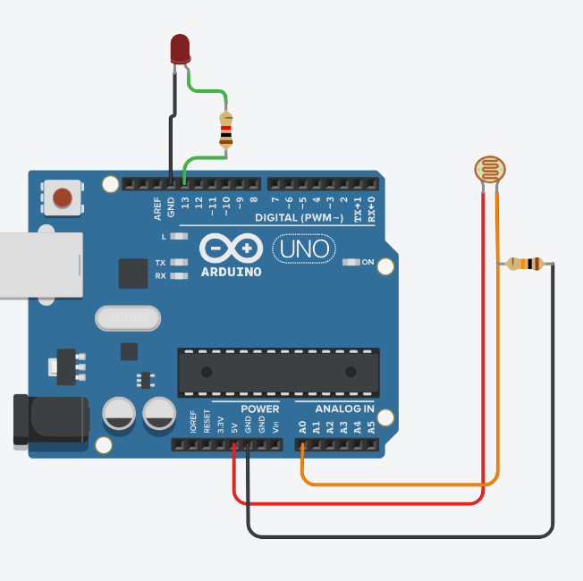

# Diagramas de Conexión - Arduino UNO

Esta carpeta reúne los esquemas y diagramas de conexión (`.png`) necesarios para armar correctamente los circuitos de los distintos sensores y componentes con una placa **Arduino UNO**.

## Índice de componentes, códigos y diagramas

| Componente | Código de ejemplo | Diagrama de conexión | Descripción |
| :--- | :--- | :--- | :--- |
| Display de 7 segmentos | [`Display_ejemplo.ino`](../Códigos_de_ejemplo/Display_ejemplo.ino) | [`Conexion_Display.png`](../Conexiones/Conexion_Display.png) | Muestra un conteo secuencial del 0 al 9 en un display de 1 dígito. |
| Fotorresistencia (LDR) | [`Fotorresistencia_LDR_ejemplo.ino`](../Códigos_de_ejemplo/Fotorresistencia_LDR_ejemplo.ino) | [`Conexion_LDR.png`](../Conexiones/Conexion_LDR.png)   [`Conexion_fotorresistencia.png`](../Conexiones/Conexion_fotorresistencia.png) | Mide el nivel de luminosidad ambiental mediante una entrada analógica. |
| LED RGB | [`RGB_ejemplo.ino`](../Códigos_de_ejemplo/RGB_ejemplo.ino) | — | Controla el encendido y la combinación de colores (rojo, verde y azul). |
| Sensor de nivel de agua (3 pines) | [`Sensor_de_nivel_agua_ejemplo.ino`](../Códigos_de_ejemplo/Sensor_de_nivel_agua_ejemplo.ino) | [`Conexion_nivel_agua.png`](../Conexiones/Conexion_nivel_agua.png) | Lee el nivel de agua en contacto con el sensor mediante señal analógica. |
| Sensor de sonido (KY-037) | [`Sensor_de_sonido_ejemplo.ino`](../Códigos_de_ejemplo/Sensor_de_sonido_ejemplo.ino) | — | Detecta picos de sonido (salida digital) y mide su intensidad (salida analógica). |
| Sensor de temperatura y humedad (DHT11) | [`Sensor_de_temperatura_ejemplo.ino`](../Códigos_de_ejemplo/Sensor_de_temperatura_ejemplo.ino) | [`Conexion_DHT_11.png`](../Conexiones/Conexion_DHT_11.png) | Obtiene lecturas de temperatura ambiente y las envía al monitor serie. |
| Sensor infrarrojo (HW-201) | [`Sensor_infrarrojo_ejemplo.ino`](../Códigos_de_ejemplo/Sensor_infrarrojo_ejemplo.ino) | [`Conexion_infrarrojo.png`](../Conexiones/Conexion_infrarrojo.png) | Detecta la presencia de obstáculos cercanos mediante una señal digital. |
| Sensor ultrasónico (HC-SR04) | [`Sensor_ultrasonico_ejemplo.ino`](../Códigos_de_ejemplo/Sensor_ultrasonico_ejemplo.ino) | [`Conexion_Ultrasonico.png`](../Conexiones/Conexion_Ultrasonico.png) | Calcula la distancia a un objeto en centímetros usando pulsos ultrasónicos. |
| [Referencias](#referencias) | [Referencias](https://www.youtube.com/watch?v=oYc0Anh0yq4) | — | [Referencias](https://www.youtube.com/watch?v=A9hCzjBc7Q4) |

---

## Esquemas de conexión

### 1. Sensor de temperatura y humedad (DHT11)

### 2. Sensor LDR

### 3. Fotorresistencia

### 4. Sensor infrarrojo de obstáculos (HW-201)

### 5. Sensor de nivel de agua

### 6. Sensor ultrasónico (HC-SR04)

### 7. Display de 7 segmentos

---

## Recomendaciones generales antes de energizar

* **Desconecta la alimentación:** Realiza o modifica todas las conexiones con el cable USB desconectado de la placa Arduino UNO.
* **Verifica la polaridad:** Asegúrate de no invertir los pines de alimentación (`5V` / `VCC` y `GND`), ya que esto puede dañar permanentemente los módulos.
* **Resistencias de protección:** Utiliza siempre las resistencias indicadas en cada diagrama (por ejemplo, en divisores de voltaje con fotorresistencias o en LEDs) para evitar cortocircuitos o lecturas erróneas.
