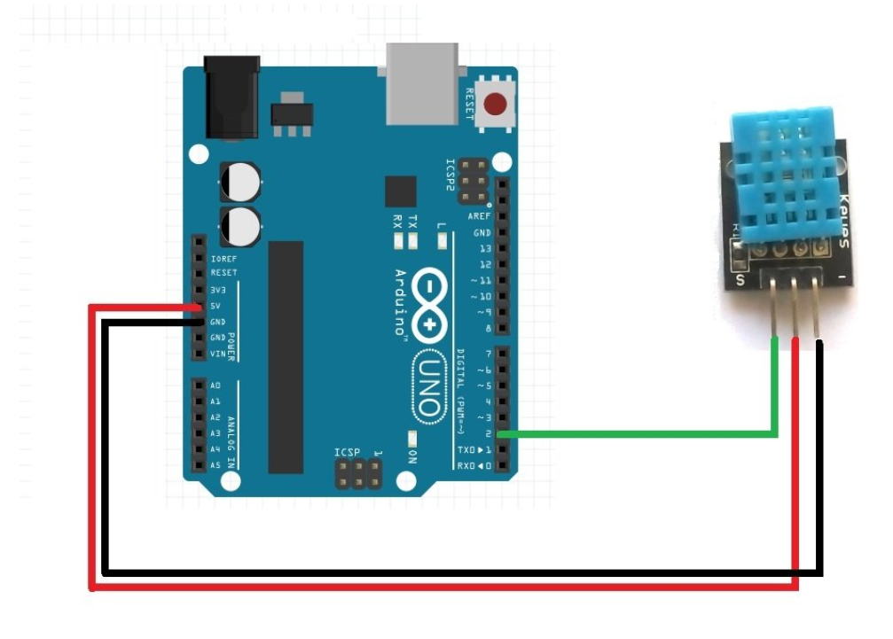
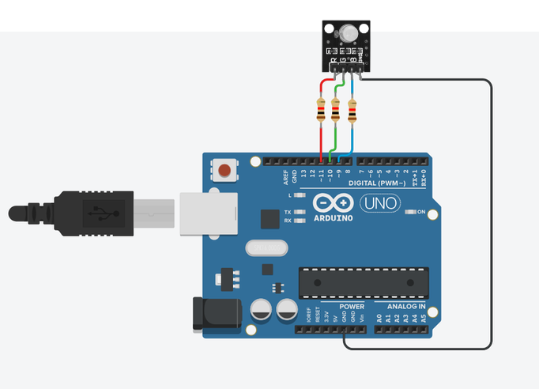
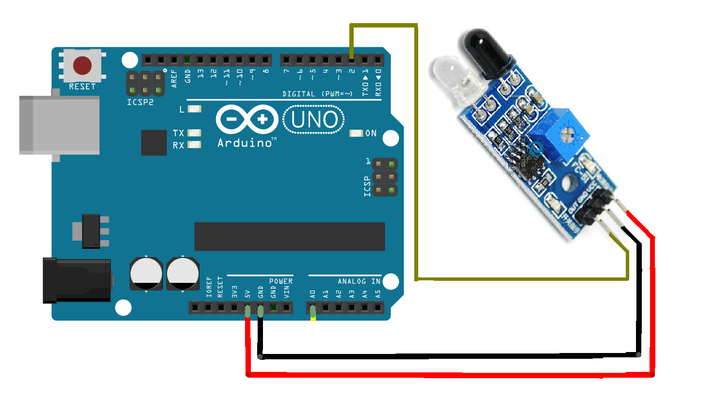
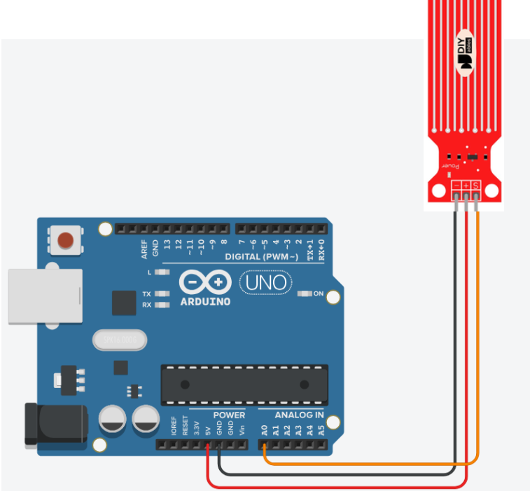
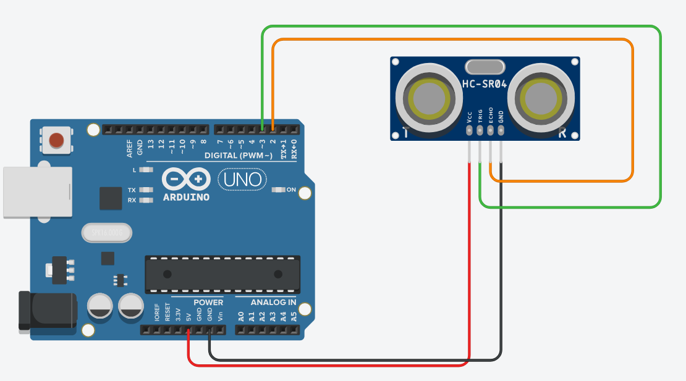

# Diagramas de Conexión - Arduino UNO

Esta carpeta reúne los esquemas y diagramas de conexión (`.png`) necesarios para armar correctamente los circuitos de los distintos sensores y componentes con una placa **Arduino UNO**.

## Índice de diagramas

| Componente | Diagrama | Código de ejemplo relacionado |
| --- | --- | --- |
| Sensor de temperatura y humedad (DHT11) | [`Conexion_DHT_11.png`](./Conexion_DHT_11.png) | [`Sensor_de_temperatura_ejemplo.ino`](../Códigos_de_ejemplo/Sensor_de_temperatura_ejemplo.ino) |
| Sensor LDR | [`Conexion_LDR.png`](./Conexion_LDR.png) | [`Fotorresistencia_LDR_ejemplo.ino`](../Códigos_de_ejemplo/Fotorresistencia_LDR_ejemplo.ino) |
| Fotorresistencia | [`Conexion_fotorresistencia.png`](./Conexion_fotorresistencia.png) | [`Fotorresistencia_LDR_ejemplo.ino`](../Códigos_de_ejemplo/Fotorresistencia_LDR_ejemplo.ino) |
| Sensor infrarrojo (HW-201) | [`Conexion_infrarrojo.png`](./Conexion_infrarrojo.png) | [`Sensor_infrarrojo_ejemplo.ino`](../Códigos_de_ejemplo/Sensor_infrarrojo_ejemplo.ino) |
| Sensor de nivel de agua | [`Conexion_nivel_agua.png`](./Conexion_nivel_agua.png) | [`Sensor_de_nivel_agua_ejemplo.ino`](../Códigos_de_ejemplo/Sensor_de_nivel_agua_ejemplo.ino) |
| Sensor ultrasónico (HC-SR04) | [`Conexion_Ultrasonico.png`](./Conexion_Ultrasonico.png) | [`Sensor_ultrasonico_ejemplo.ino`](../Códigos_de_ejemplo/Sensor_ultrasonico_ejemplo.ino) |
| Display de 7 segmentos | [`Conexion_Display.png`](./Conexion_Display.png) | [`Display_ejemplo.ino`](../Códigos_de_ejemplo/Display_ejemplo.ino) |

---

## Esquemas de conexión

### 1. Sensor de temperatura y humedad (DHT11)

### 2. Sensor LDR

### 3. Fotorresistencia

### 4. Sensor infrarrojo de obstáculos (HW-201)

### 5. Sensor de nivel de agua

### 6. Sensor ultrasónico (HC-SR04)

### 7. Display de 7 segmentos

---

## Recomendaciones generales antes de energizar

* **Desconecta la alimentación:** Realiza o modifica todas las conexiones con el cable USB desconectado de la placa Arduino UNO.
* **Verifica la polaridad:** Asegúrate de no invertir los pines de alimentación (`5V` / `VCC` y `GND`), ya que esto puede dañar permanentemente los módulos.
* **Resistencias de protección:** Utiliza siempre las resistencias indicadas en cada diagrama (por ejemplo, en divisores de voltaje con fotorresistencias o en LEDs) para evitar cortocircuitos o lecturas erróneas.
